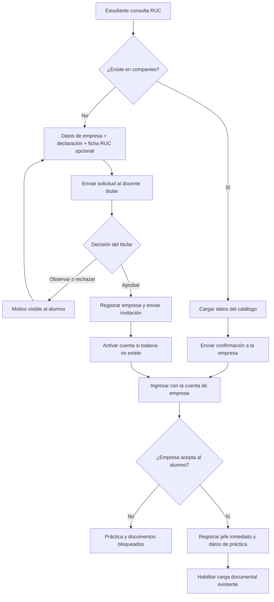

# Validación de empresas y confirmación de practicantes — backend

Implementación del 23 de octubre de 2026. No incluye frontend, bolsa laboral ni evaluación de planes e informes que desarrolla el otro equipo. Los ejemplos son datos ficticios.

## Flujo acordado



Una empresa propuesta no se crea en `companies` al enviar la solicitud. Sus datos quedan en `company_validation_requests`; el titular la incorpora al catálogo al aprobar. Por ello, las empresas del catálogo se tratan como existentes y reciben confirmación directa: no hay un flujo adicional de empresa existente sin aprobación.

Activar la cuenta **no** acepta al alumno. La empresa debe tomar una decisión explícita después de activar o iniciar sesión. No se consulta automáticamente SUNAT: la verificación por RUC busca en la BD y la comprobación externa corresponde al titular.

## Responsabilidades

- Estudiante: consultar RUC, enviar su solicitud o confirmación, declarar la veracidad, ver el estado, corregir/reintentar si se observa o rechaza, reenviar invitación y registrar la práctica después de ser aceptado.
- Docente titular, rol 3 (Quispe en el ejemplo): revisar solicitudes de su misma escuela y semestre. Puede aprobar, observar o rechazar. Observación y rechazo requieren motivo. Un titular de otra sección de la misma escuela y semestre también puede revisar.
- Docente supervisor, rol 4 (Claros): conserva seguimiento y evaluación existentes. No aprueba empresas ni acepta estudiantes por ellas.
- Empresa, tipo de usuario 3: activar su propia cuenta, consultar sus solicitudes y aceptar o rechazar estudiantes. Solo puede acceder a registros vinculados a su empresa.

Los permisos usan la asignación académica activa en sesión, verifican su propietario, rol, estado y escuela/semestre. Los perfiles bloqueados o limitados no pueden usar este flujo; los de solo lectura no pueden escribir. Los administradores no sustituyen al titular en esta aprobación.

## Base de datos

Migración nueva: `database/migrations/2026_10_23_000001_create_company_validation_workflow.php`.

- `company_validation_requests`: una solicitud vigente por asignación del estudiante, propuesta de empresa, RUC, estado, declaración con texto/versión/fecha, revisión, ficha privada y decisión empresarial.
- `company_validation_events`: historial de acciones, actor y estado anterior/nuevo. Conserva la declaración y datos enviados de cada intento.
- `company_invitations`: hash del token, correo de destino, vencimiento, consumo y revocación. Nunca se devuelve el hash por API.
- `companies`: RUC único, cuenta empresarial, representante/celular, activación y datos de la aprobación que creó la empresa.
- `users.person_id`: admite null para cuentas empresariales; no se inventa DNI ni persona. Las cuentas académicas conservan sus relaciones actuales.
- `placements`: referencia a la solicitud aceptada y declaración de los datos de práctica.

La migración se detiene si existen RUC duplicados; no fusiona ni elimina registros automáticamente. Su rollback no vuelve obligatorio `users.person_id`, para no invalidar cuentas empresariales creadas. No modificar ni renombrar las ocho migraciones futuras `.php.gitkeep`.

No se ha ejecutado esta migración en el servidor desplegado. Para un entorno local o de pruebas configurado previamente:

```sh
php artisan migrate
```

Antes del despliegue conjunto, el responsable de BD debe revisar la migración y respaldar su entorno.

## Autenticación y formato

Endpoints JSON con middleware **web** (aunque la URL empieza por `/api/`): usan la sesión existente de Fortify y protección CSRF. Para React en el mismo dominio, usar `fetch`/Axios con cookies y el token CSRF existente. Enviar `Accept: application/json`. No son endpoints públicos con bearer token de Sanctum.

Inicio de sesión: `POST /login` con `email`, `password`; cierre: `POST /logout`. La activación de empresa inicia sesión y regenera su identificador. El representante no elige su RUC, correo, tipo de usuario ni permisos: se obtienen de la invitación.

Las respuestas de solicitud usan `{ "data": { ... } }`; los listados agregan `links` y `meta` de paginación. Validaciones devuelven 422 con `errors`; acceso no permitido 403, estado incompatible 409, invitación vencida/usada 410, límite de envíos 429, recurso inexistente 404 y falta de sesión 401 para solicitudes JSON.

## Endpoints

| Método | URL | Actor y uso |
| --- | --- | --- |
| GET | `/api/company-validation/companies/{ruc}` | Estudiante: verificar RUC de 11 dígitos |
| GET | `/api/company-validation/current` | Estudiante: su solicitud actual o `data: null` |
| POST | `/api/company-validation/requests` | Estudiante: solicitud nueva o confirmación de empresa existente |
| PATCH | `/api/company-validation/requests/{id}` | Estudiante: corregir una solicitud observada/rechazada |
| GET | `/api/company-validation/requests` | Titular: solicitudes de su escuela/semestre; empresa: sus alumnos |
| GET | `/api/company-validation/requests/{id}` | Estudiante propietario, titular autorizado o empresa vinculada |
| GET | `/api/company-validation/requests/{id}/ruc-document` | Descargar ficha PDF privada con los mismos permisos |
| PATCH | `/api/company-validation/requests/{id}/review` | Titular: aprobar, observar o rechazar |
| POST | `/api/company-validation/requests/{id}/resend` | Estudiante: reenviar invitación/confirmación |
| GET | `/api/company-invitations/{token}` | Datos mínimos para la pantalla de activación |
| POST | `/api/company-invitations/{token}/activate` | Visitante sin sesión: activar cuenta empresarial |
| PATCH | `/api/company-validation/requests/{id}/decision` | Empresa: aceptar o rechazar alumno |
| POST | `/api/company-validation/placement` | Estudiante aceptado: registrar jefe inmediato y práctica |

El listado admite `?state=pending_review&per_page=15&page=1`; máximo 100 registros por página. El estado se valida contra el enum; no se aceptan filtros libres de escuela/empresa para ampliar el acceso.

### 1. Verificar RUC

Respuesta para RUC inexistente:

```json
{
  "found": false,
  "next_action": "send_request",
  "company": null,
  "declaration": {"text": "Declaro que los datos de la empresa que registro son válidos y correctos.", "version": "2026-10-v1"}
}
```

Para empresa existente, `found: true`, `next_action: send_confirmation` y `company` contiene `id`, `ruc`, `name`, `razon`, `address`, `phone`, `email`. El frontend los presenta como datos del catálogo. El servidor usa esos valores aunque el estudiante intente enviar otros en la solicitud.

### 2. Enviar solicitud de empresa nueva

```json
{
  "ruc": "20999999991",
  "name": "Empresa de prueba",
  "razon": "Empresa de prueba S.A.C.",
  "address": "Dirección ficticia",
  "phone": "999888777",
  "email": "empresa@example.test",
  "declaration_accepted": true
}
```

`razon` es opcional; si no se envía, utiliza `name`. Los otros datos corporativos son obligatorios para RUC nuevo. Para adjuntar `ruc_document`, usar multipart/form-data (PDF hasta 5 MB); no es obligatorio. En reenvíos con archivo puede utilizarse POST multipart con `_method=PATCH`.

La declaración se guarda con su texto y versión del servidor, no con un texto arbitrario del cliente. La ficha se guarda en disco privado y solo se descarga por el endpoint autorizado. No se guarda una copia pública.

Para empresa existente, enviar únicamente:

```json
{"ruc": "20999999991", "declaration_accepted": true}
```

La primera respuesta es 201 y estado `pending_review` para nueva o `awaiting_company` para existente. No hay correo antes de la aprobación de una empresa nueva. Una segunda creación para la misma asignación responde 409; usar la solicitud actual o el PATCH cuando corresponda.

### 3. Revisión del titular

```json
{"decision": "approve", "comment": "Verificación realizada"}
```

También admite `observe` o `reject`, ambos con `comment` obligatorio de hasta 2000 caracteres. Aprobar registra la empresa, cambia la solicitud a `awaiting_company` y encola el correo. Observar/rechazar no crea la empresa ni envía invitación. El alumno puede corregir y reenviar; se conserva el historial.

Si otra solicitud del mismo RUC ya fue aprobada, se reutiliza la empresa del catálogo sin sobrescribirla ni crear duplicados.

### 4. Invitación y activación

El correo institucional identifica a la empresa y al estudiante/escuela. Incluye la URL de activación o la URL para revisar solicitudes si ya tiene cuenta.

El token dura 72 horas, se guarda hasheado y se consume al activar. Reenviar revoca el anterior de esa solicitud; activar una cuenta revoca otras invitaciones de activación de la misma empresa. Reenvío: espera mínima de cinco minutos y máximo tres solicitudes por hora.

```json
{
  "representative_name": "Representante de prueba",
  "representative_phone": "999777666",
  "password": "Contrasena123!",
  "password_confirmation": "Contrasena123!",
  "terms_accepted": true
}
```

La contraseña se almacena hasheada. No se permite adjudicar por coincidencia de correo una cuenta académica o una cuenta de otra empresa: se responde 422 para que se corrija el correo. La activación responde 201, inicia sesión como empresa y devuelve `next_url`. No acepta automáticamente al alumno.

Los textos institucionales de convenio y su versión deben consolidarse con el frontend antes de publicar. El GET de invitación devuelve `terms.text` y `terms.version` desde la configuración; el backend registra texto, versión y fecha de aceptación en el historial.

### 5. Decisión de la empresa

```json
{"decision": "accept"}
```

O `{"decision": "reject", "comment": "Motivo"}`. El rechazo exige motivo y deja `declined`. La aceptación deja `accepted` y `can_register_practice: true`. Repetir exactamente la misma decisión es idempotente; cambiar una decisión ya tomada responde 409. Se notifica al alumno y se registra el actor real.

### 6. Jefe inmediato y datos de práctica

```json
{
  "company": {"id": 1},
  "internship_type": "development",
  "origin_type": "direct",
  "practice_declaration_accepted": true,
  "placement": {
    "boss_name": "Jefe de prueba",
    "boss_position": "Jefe de Sistemas",
    "boss_phone": "999888776",
    "boss_email": "jefe@example.test",
    "area_name": "Tecnología",
    "position": "Practicante",
    "description": "Funciones de la práctica",
    "start_date": "2026-04-01",
    "end_date": "2026-08-01"
  }
}
```

También puede enviarse `placement.area_id` de esa empresa en lugar de `area_name`. El backend rechaza áreas de otra empresa. El jefe inmediato se almacena en los campos existentes de `placements`; no crea una cuenta para él.

`company.id` debe coincidir con la empresa que aceptó esa asignación. Se requiere la declaración de veracidad de práctica. La respuesta devuelve `can_upload_documents: true`, `internship_id` y los datos guardados. Se crea el expediente de prácticas para la carga documental; esto no aprueba documentos ni califica la práctica. El servidor impide modificar el catálogo empresarial desde la edición de una práctica.

## Estados y frontend

| Estado | Significado | Acción siguiente |
| --- | --- | --- |
| `pending_review` | Empresa nueva enviada al titular | Esperar revisión |
| `observed` | Titular pide correcciones | Mostrar motivo y habilitar edición/reenvío |
| `rejected` | Titular rechaza la propuesta | Mostrar motivo; permitir nueva presentación corregida |
| `awaiting_company` | Invitación o confirmación enviada | Empresa activa/ingresa y decide |
| `accepted` | Empresa aceptó al alumno | Habilitar datos de práctica |
| `declined` | Empresa rechazó al alumno | Mostrar motivo; permitir otro intento |

El recurso incluye `can_resubmit`, `can_register_practice`, `can_upload_documents`, `placement_id`, `internship_id`, datos de empresa/alumno, declaraciones, historial y fechas. Antes de habilitar archivos, además de `accepted` debe existir el registro de práctica con su declaración. Los endpoints antiguos de formalización y los servicios de documentos también comprueban estos requisitos: no basta con ocultar botones.

Los documentos de acreditación/dossier y el seguimiento del supervisor conservan su flujo. Para subir un plan o informe, usar el endpoint existente `POST /internship/documents/{document}` (el parámetro de ruta se conserva por compatibilidad; la selección real usa `target_id`) con `target_id = internship_id`, `code` del tipo documental configurado y `file`. Los tipos de documento deben estar registrados en la configuración académica. La carga y revisión de planes/informes continúa con los servicios documentales existentes; este cambio no desarrolla las pantallas nuevas de ese equipo.

## Integración y despliegue conjunto

No se modificaron archivos React. El compañero debe implementar las pantallas y conectar los endpoints; las URLs del correo son configurables en `config/company_validation.php`:

- `/empresa/activar?token=...`: pantalla que consulta el GET de invitación y envía el POST de activación.
- `/empresa/solicitudes?request=...`: pantalla protegida que inicia sesión si hace falta, lista solicitudes y permite decidir.
- Notificaciones nuevas: `entity = company_validation`, con `action.route = company-validation.requests.show` y parámetro `companyRequest`; el frontend debe abrir la pantalla apropiada para el rol, no mostrar la respuesta JSON como página.

El endpoint antiguo `POST /register/company` devuelve 409 y remite a este flujo: ya no crea cuentas con contraseña predeterminada ni empresas por fuera de la solicitud/aprobación.

No publicar el backend separado del ajuste de frontend: la formalización antigua ahora exige empresa aceptada y `practice_declaration_accepted`.

Para enviar correos reales se requiere configurar SMTP y remitente institucional en el entorno. Con `QUEUE_CONNECTION=database`, mantener un worker:

```sh
php artisan queue:work --tries=3
```

`MAIL_MAILER=log` solo registra correos; no envía mensajes reales. La aplicación encola la invitación después de confirmar la transacción. Revisar las tareas fallidas con la herramienta habitual del despliegue; el alumno puede reenviar una invitación si corresponde.

## Pruebas

```sh
php vendor/bin/pest tests/Feature/Company --compact
php vendor/bin/pest --compact
composer test:lint
```

Las pruebas se ejecutan con SQLite en memoria, `Mail::fake()` y almacenamiento simulado. Cubren ambos caminos, ausencia de correo antes de aprobación, revisión y correcciones, aislamiento por escuela/semestre/empresa, declaración obligatoria, PDF privado, token vencido/usado, activación, aceptación/rechazo y bloqueo de práctica/documentos. No envían correo a terceros ni prueban SMTP real.

## Resultado de validación local

- Suite completa: **119 pruebas aprobadas, 940 aserciones**, sin fallos ni omisiones. Incluye 30 casos del nuevo flujo de empresa.
- Laravel Pint: formato PHP correcto.
- TypeScript (`tsc --noEmit`) y compilación Vite: correctos.
- Migración nueva: instalación, rollback y reinstalación comprobados en otra SQLite temporal.
- Caché de rutas: generación y limpieza correctas; las rutas históricas se conservan.
- Las pruebas de correo usan un buzón simulado; el envío SMTP real y la interfaz deben comprobarse en la consolidación.

Los cambios permanecen locales en `aldo`; no se han hecho commit, push ni migraciones sobre la base desplegada.
